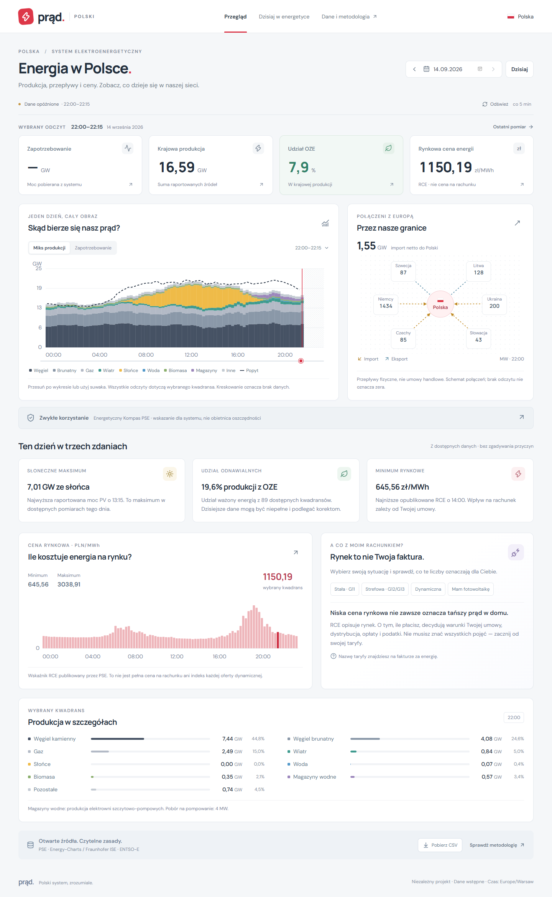

# Poland electricity dashboard

Prąd Polski is a Polish-language dashboard for Poland's electricity system. It shows generation by fuel, demand, physical cross-border flows, the RCE market price and PSE's electricity-use guidance.

The React frontend reads a local OCaml API. The API fetches public data from Energy-Charts and PSE, aligns timestamps and keeps raw JSON snapshots. No API key is required for these sources.



## What you can do

- Inspect a day and select one quarter-hour across the charts and cards.
- Browse dates from 14 June 2024, subject to each source's coverage.
- Compare generation, demand, renewable share, prices and border flows.
- See source timestamps, delayed readings and fetch errors.
- Export the selected day as CSV.

Older generation data can contain hourly averages. The dashboard labels the original hour and displays its average across the four covered quarters. It does not invent measurements within that hour. Missing observations stay empty. Warsaw daylight-saving days contain 92 or 100 quarters instead of 96.

RCE is a wholesale indicator in PLN/MWh. It is not a household electricity bill. The tariff explanations distinguish fixed, time-of-use, dynamic and PV arrangements.

## Repository layout

```text
src/                 React UI, runtime schemas and unit tests
public/              Static browser assets
backend/bin/         OCaml HTTP service and background refresh
backend/lib/         Source requests, storage and normalization
backend/test/        Backend regression tests
tests/               Browser tests and local startup checks
docs/                Screenshots and implementation reviews
deploy/              Nginx configuration
.github/workflows/   Frontend and backend checks
compose.yaml         Frontend, backend and persistent data volume
```

Both applications live in this repository so a commit can update the API and its consumers together. `data/`, build output, dependencies and local logs are ignored by Git.

## Run locally

You need Node.js 24 or newer, npm, opam and curl. Run the backend on Linux, macOS or Windows WSL. On Debian or Ubuntu, install `build-essential`, `pkg-config`, `libgmp-dev` and `libev-dev` before installing the OCaml dependencies.

Start the backend in one terminal:

```sh
cd backend
opam switch create . ocaml-base-compiler.5.5.0
opam install . --deps-only --locked
opam exec -- dune build
opam exec -- dune exec bin/main.exe
```

Start the frontend in another terminal, from the repository root:

```sh
npm ci
npm run dev
```

Open http://127.0.0.1:5173. Vite forwards `/api` requests to http://127.0.0.1:8080. The first load can take several seconds while the backend fetches source data.

The frontend uses React and TypeScript with Vite. The backend uses OCaml 5.5.0, Dune, Cohttp/Lwt, Yojson and Ptime. Dependency versions are recorded in `package-lock.json` and `backend/prad_polski.opam.locked`.

### Configuration

| Variable     | Default                 | Used by                     |
| ------------ | ----------------------- | --------------------------- |
| `API_TARGET` | `http://127.0.0.1:8080` | Vite proxy                  |
| `HOST`       | `127.0.0.1`             | Backend listener            |
| `PORT`       | `8080`                  | Backend listener            |
| `DATA_DIR`   | `../data`               | Backend cache and snapshots |

Paths are relative to the backend's working directory. Create the parent directory before using a custom `DATA_DIR`. Run one backend process per data directory.

### Windows shortcut

After installing frontend dependencies on Windows and building the backend in WSL, run `./start-local.ps1` from PowerShell. It starts both services without opening extra windows and writes logs under `.local-run/`.

The default WSL distribution is `Ubuntu-24.04`. Use `-Distribution` to select another installed distribution. Set `NODE_BIN` to a Node 24+ executable if needed. The launcher also recognizes the local Codex Node runtime. Do not share `node_modules` between Windows and Linux.

### Docker

```sh
docker compose up --build
```

Open http://127.0.0.1:8088. Nginx serves the frontend and forwards API requests to OCaml. The `energy-data` volume keeps source responses across container restarts. The Docker configuration is included, but container deployment has not been verified in this workspace. See [validation notes](VALIDATION.md).

## Data sources

| Source                                                          | Endpoint                      | Use                                                       |
| --------------------------------------------------------------- | ----------------------------- | --------------------------------------------------------- |
| [Fraunhofer ISE Energy-Charts](https://api.energy-charts.info/) | `/v2/public_power?country=pl` | Generation and demand, including source interval duration |
| [PSE reports](https://api.raporty.pse.pl/)                      | `/api/przeplywy-mocy`         | Physical flows across Poland's six reported borders       |
| [PSE reports](https://api.raporty.pse.pl/)                      | `/api/rce-pln`                | RCE in PLN/MWh                                            |
| [PSE reports](https://api.raporty.pse.pl/)                      | `/api/pdgsz`                  | Active Energetyczny Kompas guidance                       |

Energy-Charts provides public net production based on ENTSO-E data. Generation totals exclude load, trade and storage consumption. Storage discharge is included in total generation and excluded from renewable generation. The historical source inventory can omit offshore wind and batteries; explicit null readings remain unknown.

PSE flow values describe physical exchange. The backend combines both directions for each border. The national net requires complete coverage of all six borders. These flows do not identify the origin of electricity consumed in a home.

Energy-Charts timestamps identify interval starts. PSE price and flow timestamps identify interval ends. The backend preserves UTC boundaries and the UI displays Warsaw time. PSE guidance is hourly and uses only active publications.

## History and snapshots

Historical data is requested from the upstream APIs on demand. A database is not required to browse it. Today and yesterday refresh after five minutes; older dates use a six-hour cache. Background ingestion refreshes today.

Each successful fetch writes a raw JSON snapshot with its retrieval time, then replaces the current cache file. Unique snapshot names preserve successive revisions, even when fetched within the same second. Existing snapshots from the older source integration remain on disk. The v2 generation cache has a separate filename so it cannot reuse an incompatible v1 response.

Mount or back up `DATA_DIR` to retain snapshots. The application has no automatic retention policy or complete historical backfill. Upstream historical responses can change after corrections, so keep snapshots when you need to reproduce what was published at an earlier time.

The public dashboard API retains a quarter-hour grid. `generationStart` and `generationEnd` identify the source interval for generation, demand and the generation mix. Hourly averages repeat across their covered quarters. CSV exports include these boundaries. Duration-weighted summaries count the covered time once.

## Local API

- `GET /api/health` reports service status and the OCaml runtime version.
- `GET /api/v1/day?date=YYYY-MM-DD` returns the date, timezone, source status and quarter-hour points.

Measurements are nullable. A successful HTTP response does not mean every upstream source is available or current. Source failures can use an identified cached response for the same date. Invalid dates return 400 and unsupported methods return 405.

## Checks

```sh
npm run check
cd backend
opam exec -- dune runtest
```

The frontend check runs TypeScript, linting, formatting, unit tests and the production build. With both servers running, execute browser tests from the repository root:

```sh
npm run test:e2e
```

Browser tests use installed Microsoft Edge by default. On Linux, install Chromium with `npx playwright install chromium` and set `PLAYWRIGHT_CHANNEL=chromium`. Most tests use fixtures; the live integration test needs upstream services.

## Current limits

- Source coverage and publication delays vary. Historical PSE coverage is separate from Energy-Charts coverage.
- The file store supports one service process. It has no cross-process locking or automatic retention.
- Bulk backfills need request throttling and HTTP 429 retry handling before production use.
- There is no carbon-intensity model, forecast, tariff optimizer, account system or device control.
- Public deployment needs a host for the OCaml process, HTTPS and persistent storage.

## Attribution

Data comes from [Polskie Sieci Elektroenergetyczne](https://www.pse.pl/dane-systemowe), [Fraunhofer ISE Energy-Charts](https://www.energy-charts.info/) and underlying [ENTSO-E Transparency Platform](https://transparency.entsoe.eu/) records. Energy-Charts v2 responses state CC BY 4.0 attribution to energy-charts.info. Check the applicable source terms before redistributing data.

This is an independent project. These organizations do not endorse it.
